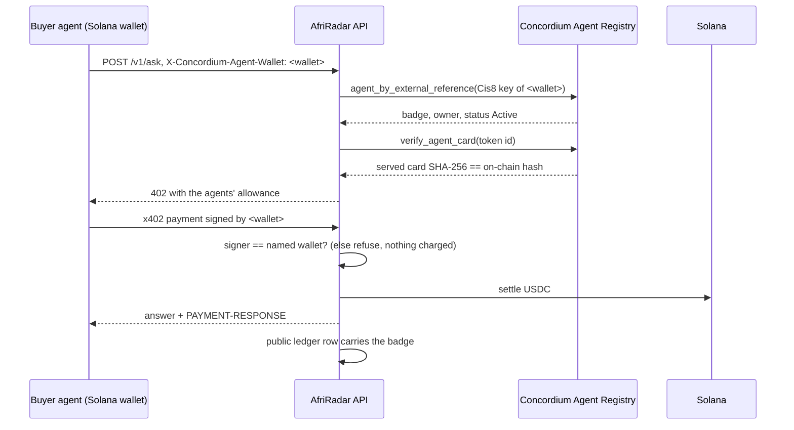

# AfriRadar on Concordium: pay, prove, then access

AfriRadar sells official Nigerian and Kenyan fund data to AI agents, one request at a time, paid in USDC on Solana over x402. With Concordium's Agent Registry it now knows **which agent is paying**: before a buyer gets more access, AfriRadar checks on Concordium that the Solana wallet signing the payment belongs to a registered, active agent whose owner is a verified Concordium account. Buyers can check AfriRadar the same way before they pay.

<!-- FILL 20 Nov after registration: badges, token ids, tx links, video. -->

| | |
|---|---|
| Registration page, live status from Concordium | https://api.afriradar.com/concordium |
| Is this wallet a verified agent? (free) | https://api.afriradar.com/v1/agents/2VJtvNGAYZiFAejH4nVWDmw2pjoFtgEQsVFsAV2LpXTK?network=devnet |
| Public payment ledger, with badges | https://api.afriradar.com/v1/payments |
| AfriRadar's Agent Card (seller) | https://api.afriradar.com/.well-known/agent-card.json |
| Demo buyer's Agent Card | https://api.afriradar.com/agents/buyer.json |
| Registry contracts (Concordium testnet) | CIS-8004 Agent Registry `12802,0`, CIS-8 external keys `12801,0` |
| Owner account | `4mX6mBtX2FUgoW8hMio2hcjZsh57hcPG2gN9vTi71bYrb5FoTj` |
| Seller badge | _filled at registration_ |
| Buyer badge | _filled at registration_ |
| Demo video | _filled at recording_ |

## The problem

Agents already pay for data with x402: a wallet signs a USDC payment and gets the answer back. But a wallet is only a key. A data seller cannot tell a well-run agent from a throwaway wallet, so it treats every buyer as a stranger: the same tight limits for everyone, and nothing a buyer can earn. Buyers have the same blind spot in reverse: the `payTo` address in a 402 says nothing about who receives the money.

## What Concordium adds

Concordium's Agent Registry gives a Solana wallet an owner and a record anyone can check:

1. **The wallet is bound to a Concordium account (CIS-8).** The wallet signs Concordium's canonical bytes with its own ed25519 key, and the CIS-8 contract checks that signature on chain before it records the binding. Only the holder of the Solana key can create it, and only the named Concordium account can submit it.
2. **The agent is registered (CIS-8004).** The owner mints the agent's badge, an NFT whose external reference is the bound Solana key, and which anchors the SHA-256 of the agent's public Agent Card.
3. **AfriRadar checks all of it when a wallet pays.** A paying wallet counts as a verified agent only when the binding exists, the agent is `Active`, and the card served today still hashes to the value on chain. A revoked agent stops counting within the hour.



## What a verified agent gets

| | Any visitor | Verified Concordium agent |
|---|---|---|
| Paid questions on Solana mainnet | 30 an hour per visitor | 300 an hour, per badge and visitor |
| Public ledger | wallet address | wallet address and badge, with a link to check it |
| How it is earned | nothing to do | name the wallet in `X-Concordium-Agent-Wallet` and pay from it |

The claim is held to account at payment time. After x402 verifies the payment and before anything settles, AfriRadar compares the wallet that actually signed it with the wallet the buyer named. If they differ, the request is refused and nothing is charged. A stranger who names someone else's verified wallet uses up only their own allowance.

## AfriRadar's own agents

Both are registered from the owner's Concordium Browser Wallet on the [registration page](https://api.afriradar.com/concordium), which builds each call with Concordium's registry service and shows each step's status read back from the chain.

| Agent | Solana wallet | Bound on | Why |
|---|---|---|---|
| AfriRadar Data API (seller) | `CEunt52v96nuGTroYhigYhVQyZbDpaWZ69g6isL4BQT8` | Solana mainnet | The treasury every payment goes to. A buyer can check, before paying, that the `payTo` in the 402 belongs to a registered agent. |
| AfriRadar demo buyer | `2VJtvNGAYZiFAejH4nVWDmw2pjoFtgEQsVFsAV2LpXTK` | Solana devnet | Pays the API every hour (the monitor at `/v1/status`), so verified-agent payments appear in the ledger around the clock. |

Each card is served byte for byte, so anyone can fetch it, hash it and compare with the registry. A card names its own badge only after the badge exists, so registration has three steps per agent: bind the wallet, register with the first card, then pin the card that carries its token address (`setAgentURI`).

## Concordium features used

| Concordium | Where in AfriRadar |
|---|---|
| CIS-8 `registerExternalKey`, scheme `solana-ed25519` | Both Solana wallets bound to the owner account. Signatures made offline from the key files by `scripts/concordium-sign.ts`; the public signatures are in `src/concordium/agents.ts` and checked by test. |
| CIS-8004 `register` with a `Cis8` external reference | Both agents, from the registration page. |
| CIS-8004 `setAgentURI` | Pins each card once it carries its badge. |
| CIS-8004 `agent_of` status and metadata hash | Every verification (`src/concordium/registry.ts`). |
| Verified by Concordium badge, A2A extension `concordium-badge/v1` | In both Agent Cards, with `x402Support: true`. |
| Agent Registry MCP service | Every read (`agent_by_external_reference`, `verify_agent_card`, `owner_of_key`) and every transaction builder (`build_cis8_register`, `build_register`, `build_set_agent_uri`). It holds no keys. |
| Concordium Browser Wallet | Signs and sends each registry call, with the contracts' embedded schemas so the wallet can show what it signs. Encoding the service's parameters with those schemas gives byte for byte the service's own `parameter_hex` for all three calls. |
| x402 | Payments stay on Solana; Concordium decides who the payer is and what it may do. |

## Check it in a minute

```bash
# 1. Is the demo buyer a verified agent? (free, no wallet)
curl -s "https://api.afriradar.com/v1/agents/2VJtvNGAYZiFAejH4nVWDmw2pjoFtgEQsVFsAV2LpXTK?network=devnet"

# 2. Ask Concordium directly, without AfriRadar in the middle
curl -s "https://agent-registry-mcp.concordium.com/v1/check-badge/<buyer badge>"

# 3. Hash AfriRadar's card yourself and compare with the on-chain metadata_hash from step 2
curl -s https://api.afriradar.com/.well-known/agent-card.json | sha256sum

# 4. See the badge beside the demo buyer's payments in the public ledger
curl -s "https://api.afriradar.com/v1/payments?limit=5"
```

Or open the [registration page](https://api.afriradar.com/concordium): it reads both agents' binding, badge and card hash live from Concordium testnet, with no wallet needed to read.

## Tests

`npm test` runs the whole API suite (139 tests). The Concordium tests are in `test/concordium.test.ts` and `test/app.test.ts`, named after what they defend, for example:

- `verifies only an Active agent whose card matches its on-chain hash`
- `does not verify a wallet with no agent, a revoked agent, or a card that changed`
- `never verifies when the registry cannot be read, and never throws`
- `picks up a revocation within the hour after it happens`
- `refuses, before any charge, a payment signed by a different wallet than the one named`
- `holds a valid solana-ed25519 signature from each wallet over its CIS-8 canonical bytes`
- `serves each Agent Card byte for byte, and the plan names that exact card's hash`
- `writes nothing for a wallet that never paid here, and limits checks per visitor`
- `a stranger naming a verified agent's wallet uses up only their own allowance, not the agent's`

## How it is built

- `src/concordium/registry.ts`: the lookup. A Solana address is its ed25519 key; the registry is asked for the agent whose `Cis8` external reference is that key, then for its card check. Results are kept for an hour; a failed lookup never verifies and is never kept.
- `src/concordium/access.ts`: the agents' allowance and the check that the payment's signer is the named wallet.
- `src/concordium/agents.ts`: AfriRadar's two agents and their Agent Cards.
- `src/concordium/page.ts`, `src/concordium/schemas.ts`: the registration page and the registry contracts' schemas.
- `src/app.ts`: `GET /v1/agents/:wallet`, badges in `/v1/payments`, the x402 hook that holds a named wallet to account, and the cards.

The feature is a setting: `CONCORDIUM_AGENTS=testnet` (or `mainnet`) turns the checks on. The free check stores results only for wallets that have paid AfriRadar, and runs 60 times an hour per visitor, so it cannot be used to spend the database's write allowance or the registry service.

## Path to mainnet

AfriRadar already sells on Solana mainnet for real USDC. Moving the Concordium side is a setting and a registration, not a rewrite:

1. **Contracts:** the mainnet Agent Registry (`10082,0`) and CIS-8 registry (`10081,0`) are already in `src/concordium/registry.ts`; `CONCORDIUM_AGENTS=mainnet` selects them.
2. **Owner identity:** the owner already holds a mainnet Concordium account with a verified identity (Digital Trust Solutions), so the same three steps run there from the same page.
3. **Cards:** the cards switch their chain ids and contract references to mainnet by the same setting.
4. **Reads without a middleman:** the registry service is convenient but optional. The same reads (`agent_of`, the CIS-8 key lookup) go straight to a Concordium node over gRPC with `@concordium/web-sdk`, which keeps the check working even if the service is down.
5. **For other sellers:** the check is one function with no AfriRadar-specific logic. Any x402 seller can ask "is the wallet that just paid me a verified Concordium agent?" with the same call.

## Who built it

Oluwasogo Ajala, Rising Technology, Kano, Nigeria. AfriRadar's fund data site and its paid API are live at [afriradar.com](https://afriradar.com) and [api.afriradar.com](https://api.afriradar.com).
